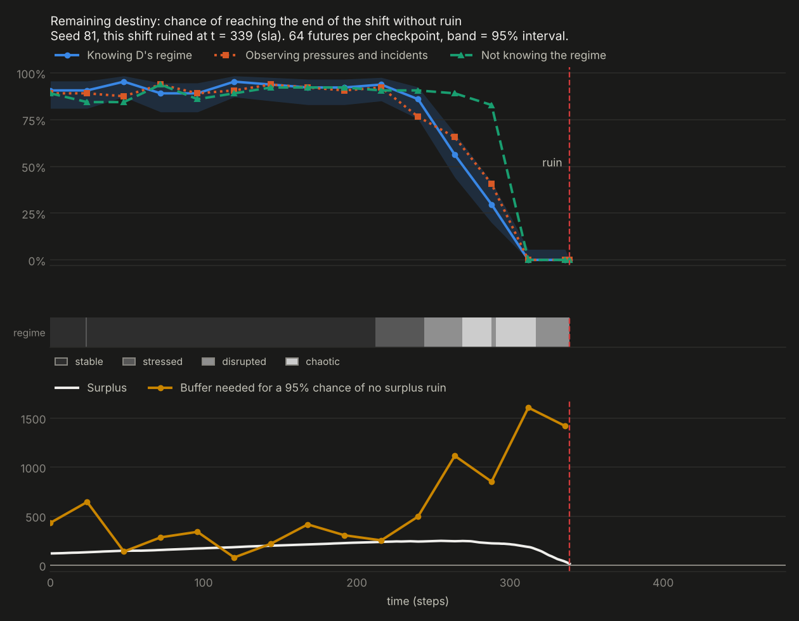
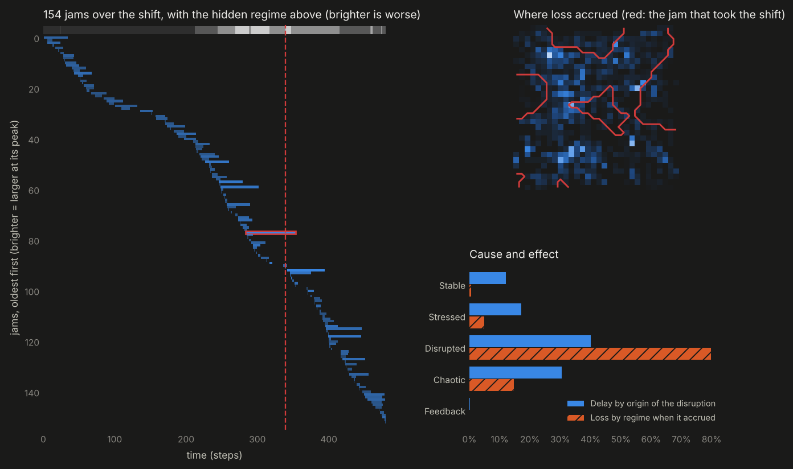

# RUIN: Ruin-probability Unified In Networks

**Destiny-framed ruin risk for stochastic logistics flow.**

[](https://www.python.org/)
[](https://opensource.org/licenses/MIT)
[](https://github.com/nezpik/ruin)

RUIN is a research-grade framework for measuring when physical logistics systems run out of destiny. It translates quantitative finance concepts (ruin theory, jump-diffusion, Monte Carlo paths, VaR, Expected Shortfall, bootstrap confidence intervals) into a logistics language built around **physical uncertainty**, **service failure**, and **systemic collapse**.

The central object is the **Probability Square** — an abstract two-dimensional **destiny frame `D`** inside which many **Q dots** (delivery commitments, route obligations, flow units) move through possible futures.

RUIN does not try to predict the future perfectly. It gives chaos a bounded frame so that uncertainty can move, organize, propagate, and become measurable.

---

## Core Philosophy

> A physical system ruins when it runs out of destiny.

In RUIN:
- **`D`** (the destiny frame) bounds all possible futures. Q dots cannot leave `D`.
- **Q dots** are quantized attempts at order — they drift, jump, cluster, stall, recover, fail, or ruin inside the frame.
- **Disruption** is spatial and propagating: a field that intensifies, spreads, decays, and reshapes movement.
- **Ruin** occurs when operational surplus is exhausted or service-level barriers are breached.
- **Visualization** is analysis: the Probability Square makes the negotiation between order and chaos visible.

---

## How the Model Works

- **Q dots travel and can succeed.** Each Q dot enters `D` with an origin, a destination, and a time window. Delivered on time, it earns surplus. Once late, it drains surplus every step until it is delivered late or abandoned.
- **Demand keeps arriving.** New Q dots enter every step, so the shift is a flow, not a fixed population running down a clock.
- **Travel is a jump-diffusion.** Progress per step is drift slowed by local field drag, plus Gaussian noise, minus occasional compound Poisson setbacks.
- **D has a hidden regime.** D is stable, stressed, disrupted, or chaotic, and the regime is what generates disruption: in persistent bursts, with heavy-tailed sizes. You see its footprint in the pressures, never the regime itself. See [A Regime-Driven D](#a-regime-driven-d).
- **Disruption is a field of events.** Shocks land on the grid, spread to neighbouring cells, and fade. The field is subcritical by construction: a shock can never amplify itself, even where jams make it linger. By default it reflects at the edges: disruption, like Q dots, cannot leave `D`.
- **Q and D co-evolve.** The field slows Q dots; late and failed Q dots add disruption where they stand and push the regime toward worse levels; healthy flow resists escalation.
- **Ruin is uncertain.** With no disruption the reference shift never ruins. In the reference scenario about one shift in six does, at very different times, most by exhausting the surplus and some by breaching the SLA.

Everything is seeded and reproducible, Monte Carlo runs in parallel, and a 480-step path takes about 0.2 s.

See [CHANGELOG.md](CHANGELOG.md) for what changed in each version and how to migrate a config.

---

## A Regime-Driven D

Most simulators draw disruption as a constant drizzle of independent small shocks. Averaged over a shift that is almost deterministic, and it is not how logistics behaves: disruption arrives in bursts, a bad stretch is followed by another, and the system's own state changes how likely the next burst is. RUIN models `D` accordingly.

`D` is in a **regime**: stable, stressed, disrupted, or chaotic. The regime moves one level at a time and stays where it is for a while. Each level changes how often shocks arrive, how big they are, and how noisy travel is. The regime is **hidden**: what you observe is its footprint in the pressures (the D-state label), which is why the two disagree about a quarter of the time. In the reference scenario the D-state label matches the hidden regime exactly 73% of the time and is within one level 97% of the time.

The regime and the pressures **co-evolve**. Late deliveries raise chaos pressure, chaos pressure pulls the regime toward worse levels, a worse regime brings more and larger shocks, and healthy flow resists escalation and speeds recovery. Where Q dots are stalled, disruption also lingers, so jams persist, but retention is capped below 1 and the field still cannot amplify itself.

All of this is opt-in (`probability_square.regime.enabled`). With it off, disruption is memoryless and the model is exactly what it was in v0.6; `examples/urban_ruin_shift_thin.yaml` is that version of the scenario.

### Does it behave like logistics?

There is no data to calibrate against yet, so RUIN checks the model against qualitative regularities that logistics operations are widely reported to show. These are properties a model should have, not proof that it is right; I have not checked sources for them here.

```bash
uv run ruin facts --config examples/urban_ruin_shift.yaml
```

| Fact | Scenario | Memoryless version | Needed |
| --- | --- | --- | --- |
| Disruption clusters (Fano factor of events per 24 steps) | 3.41 | 1.0 | ≥ 1.5 (Poisson is 1) |
| Bad stretches persist (correlation of adjacent 12-step windows) | 0.48 | 0.01 | ≥ 0.15 |
| Shift loss is heavy-tailed (95th over 50th percentile) | 8.54 | 1.91 | ≥ 3 and ≥ 1.5× memoryless |
| Trip times are heavy-tailed (99th over 50th percentile) | 2.6 | 2.44 | ≥ 2 |
| Good days and bad days (variation of delayed-trip share across shifts) | 0.57 | 0.19 | ≥ 2× memoryless |
| Flaw of averages (mean loss over memoryless at equal mean disruption) | 1.82× | 1× | ≥ 1.1× |
| D-state follows the hidden regime without revealing it (correlation / exact match) | 0.65 / 0.73 | n/a | ≥ 0.5, exact < 0.9 |
| Pressure pushes the regime (escalation ratio when pressure points higher) | 1.55× | n/a | ≥ 1.3× |

The memoryless version of the same scenario passes one of the six facts that apply to it (trip tails, which it has by nature) and fails the other five, so the suite can fail.

### How much does the answer depend on the shape of disruption?

```bash
uv run ruin structure --config examples/urban_ruin_shift.yaml
```

runs the scenario under four structures that deliver the **same realised mean disruption** (148 units of shock mass per step, measured over whole shifts):

| Structure (same realised mean disruption) | Ruin probability | 95% interval | Mean loss | Expected shortfall |
| --- | --- | --- | --- | --- |
| Memoryless, exponential sizes | 0.0% | 0.0% to 0.9% | 84 | 194 |
| Memoryless, heavy-tailed sizes | 0.0% | 0.0% to 0.9% | 85 | 221 |
| Hidden regime, exponential sizes | 11.8% | 8.9% to 15.3% | 147 | 943 |
| Hidden regime, heavy tails, lingering jams (the scenario) | 15.5% | 12.3% to 19.4% | 183 | 1267 |

Two things stand out:

- **At the same average disruption, the memoryless world never ruins.** Ruin in this scenario is a property of crises, not of the average level of disruption. If real disruption were not clustered, this operation would be safe.
- **Heavy tails alone changed almost nothing for ruin** (a mild rise in the tail loss). A shock is already large enough to block a cell for a long time, so making the biggest ones bigger adds little; burstiness is what matters here.

A ruin probability should therefore be read as a statement about a structure, not as a number. The structural spread across these four, 0% to 16%, is larger than the Monte Carlo interval around any one of them.

---

## Quickstart

### Install (with uv — recommended)

```bash
git clone https://github.com/nezpik/ruin.git
cd ruin
uv sync --dev
```

Alternatively (classic pip):

```bash
python -m pip install -e ".[test]"
```

Requires Python ≥ 3.11. Core dependencies: `numpy`, `pydantic`, `matplotlib`, `pyyaml`.

### Run One Visible Trajectory + GIF

```bash
uv run ruin simulate --config examples/urban_ruin_shift.yaml --max-steps 150 --visualize --output /tmp/ruin_shift.txt
```

This produces:
- Text frames (`/tmp/ruin_shift.txt`)
- Real animated GIF (`/tmp/ruin_shift.gif`) showing the disruption field propagating, Q dots travelling to their destinations (magenta when late, green on delivery, red on failure), the D-state, and the pressures

### Run Monte Carlo Risk Analysis (Parallel)

```bash
uv run ruin risk --config examples/urban_ruin_shift.yaml --jobs 4
```

Output for the 1,000 paths the config asks for (`time_to_ruin` list omitted):

```json
{
  "paths": 1000,
  "ruin_probability": 0.16,
  "ruin_probability_ci": [0.1386, 0.184],
  "ruin_by_surplus": 131,
  "ruin_by_sla": 29,
  "mean_loss": 188.469,
  "mean_loss_ci": [169.8396, 207.7931],
  "loss_std": 307.7357,
  "value_at_risk": 837.0866,
  "value_at_risk_ci": [651.9906, 943.6986],
  "expected_shortfall": 1260.2749,
  "expected_shortfall_ci": [1089.8598, 1430.3121],
  "loss_share_by_type": {"STANDARD": 0.2204, "EXPRESS": 0.7469, "BULKY": 0.0327},
  "expected_shortfall_by_type": {"STANDARD": 359.2645, "EXPRESS": 834.5985, "BULKY": 66.4119},
  "share_of_qdots_with_loss": 0.008035,
  "loss_share_of_top_1pct_qdots": 0.9639,
  "mean_regime_occupancy": {"STABLE": 0.7454, "STRESSED": 0.1645, "DISRUPTED": 0.0672, "CHAOTIC": 0.023},
  "mean_final_surplus": 198.6578,
  "mean_min_surplus": 30.5528,
  "mean_on_time_rate": 0.9917,
  "mean_time_to_ruin": 243.71,
  "confidence_level": 0.95,
  "n_jobs": 4
}
```

How to read it:

- Every `*_ci` is a confidence interval at `confidence_level`. The ruin probability uses a Wilson interval, which stays informative even when no path ruins. The loss figures use a bootstrap.
- Each path runs to the end of the shift even after it ruins, so the loss figures describe whole shifts and are not cut off at the moment of ruin.
- `ruin_by_surplus` / `ruin_by_sla` say which barrier was hit first. The SLA is breached when the share of deadlines missed over the last `sla_window` steps reaches `sla_threshold`.
- The loss is heavy-tailed: the expected shortfall is about seven times the mean loss, which is what bad days look like.
- `mean_regime_occupancy` is the share of time D spent in each hidden regime.
- `expected_shortfall_by_type` splits the Expected Shortfall among Q-dot types; the parts add up to the total.
- `share_of_qdots_with_loss` and `loss_share_of_top_1pct_qdots` say how concentrated the loss is: under 1% of Q dots carry essentially all of it.

The `--jobs` flag controls parallelism (defaults to available cores).

---

## Seeing the Regime: the Observer

Nobody sees the regime of `D`. An operator sees pressures, and perhaps an incident log; the D-state label is a crude reading of those. A hedging policy that triggers on the true regime would be clairvoyant and would overstate its own value, so RUIN includes an **observer**: a Bayes filter that turns what has been seen into a probability for each regime.

```bash
uv run ruin observer --config examples/urban_ruin_shift.yaml
```

fits the filter on simulated shifts and scores it against the true regime on 80 held-out shifts (38,000 steps):

| Way of knowing the regime | Log score | Brier | Gap between forecast and outcome, mid-range | Precision of "disrupted or worse" at the label's recall |
| --- | --- | --- | --- | --- |
| Knowing nothing (the stationary mix) | −0.750 | 0.393 | 0.072 | n/a |
| The D-state label | n/a | n/a | n/a | 0.48 |
| Pressure filter | −0.541 | 0.299 | 0.043 | 0.71 |
| Pressure filter with an incident feed | −0.474 | 0.262 | 0.024 | 0.79 |

Higher log score and lower Brier are better; the filter's beliefs are close to calibrated, so "70%" comes true about 70% of the time. The filter is exact where it can be: the regime chain is known and its transitions depend only on pressures the observer sees. The likelihood of a pressure reading under each regime is a fitted Markov-switching model, and an incident feed (shocks per step) adds an exact Poisson likelihood.

**The first version was worse than useless.** Treating each pressure reading as independent evidence (they are not: the disruption field remembers) made it overconfident, with a log score of −0.80 against −0.77 for ignoring the pressures entirely. Three lags, a likelihood temperature chosen on held-out shifts, and a per-regime bias correction fixed it. At a plain 50% cut-off the filter notices the start of a crisis later than the D-state label does (about 10 steps against 2.5), in exchange for far fewer false alarms.

Two idealisations to keep in mind. The model is fitted with the true regime labels, which a real operator never has (they would fit it on unlabelled history, which should do somewhat worse). And an observer is fitted to one scenario and filters with that scenario's regime model.

### What is an observer worth?

`ruin destiny --observer` puts the observer's view next to the other two. Over 32 unselected shifts (6 of which ruined), in the checkpoints where the true regime was disrupted or chaotic, the observer closes **31%** (95% interval 14% to 43%) of the gap between knowing nothing about the regime and knowing it, and **36%** (21% to 47%) with an incident feed. So an operator reading the pressures recovers about a third of what a clairvoyant would know, which is what a policy triggered on observations can be expected to capture.

Scored against what actually happened, every view beats a constant forecast (Brier 0.080 knowing the regime, 0.086 observing pressures and incidents, 0.090 observing pressures, 0.091 knowing nothing, against 0.109 for the constant). The difference between the observer and knowing nothing is not distinguishable from zero in this sample (−0.001, interval −0.011 to +0.008; −0.006, interval −0.014 to +0.002 with incidents). Six ruined shifts are too few to settle it.

---

## Remaining Destiny

`ruin risk` answers "how often does a shift like this ruin?". `ruin destiny` answers the question the project is named for: *how much destiny does this shift have left, right now?*

```bash
uv run ruin destiny --config examples/urban_ruin_shift.yaml --seed 81 --blind --observer --incidents --plot destiny.png
```

It follows one shift. Every 24 steps it freezes the exact present (every Q dot, every cell of the disruption field, the surplus, the SLA window, the hidden regime) and plays 64 independent futures forward from it. The share that reach the end of the shift without ruin is the shift's **remaining destiny** at that moment:

```text
destiny(t) = P(no ruin before the horizon | everything known at t)
```



This shift ran calm for over 200 steps at about 90% destiny. Then the regime escalated, from stressed to disrupted to chaotic, and the destiny fell to 56% at step 264 and 30% at step 288, then to nothing, and the shift ruined at step 339 by breaching the SLA. Look at the bottom panel: **surplus was at its highest (245) when the crisis began**. A surplus chart sees nothing wrong until it is too late; the buffer the shift would have needed for a 95% chance of safety jumped from about 250 to over 1,100.

The chart shows three views of the same shift. The solid curve knows everything about D, including the hidden regime. The dotted curve is an observer who sees the pressures and an incident log (see [the observer](#seeing-the-regime-the-observer)). The dashed curve knows everything except the regime, which it redraws from its long-run mix. At step 264 the three say 56%, 66%, and 89%; at step 288, 30%, 41%, and 83%. The gap between the solid and dashed curves is what knowing the regime is worth, and the dotted curve shows how much of it can be had by watching.

This is a crisis chosen to make the point. Over 32 unselected shifts the observer closes about a third of that gap in severe regimes, not the three quarters it appears to here.

At `t = 0` the remaining destiny is one minus the ruin probability, so the two commands cross-check each other.

---

## Chaotic Organization

Disruption is not only disorder. Blocked regions form, persist, merge, and clear; Q dots pile up in them; loss concentrates in them. `ruin organize` measures that structure.

```bash
uv run ruin organize --config examples/urban_ruin_shift.yaml                                     # a typical shift
uv run ruin organize --config examples/urban_ruin_shift.yaml --seed 81 --plot organization.png   # one shift
```



A **jam** is a connected region where disruption blocks at least half a cell (at least three cells). Jams are tracked from step to step, so each has a birth, a lifetime, a peak, merges and splits, and a record of the Q dots and loss that passed through it. Around them the recorder measures **pile-up** (Q-dot density inside jams over the same cells' own baseline), **diversion** (flow beside jams, which is not density: Q dots also queue there), **corridors** (persistent excess flow beside jams, kept only if it is statistically significant and at least three cells long), **pressure zones** and whether they stay put, **recovery** after a jam clears, and **ruin zones**: where loss concentrates and which jam carried it before ruin. Every comparison uses each cell's own quiet-step baseline, so the geometry of `D` is not mistaken for organization.

Over 80 shifts, with the memoryless version of the scenario matched to the same realised mean disruption (± is the standard error across shifts):

| | Memoryless disruption | Hidden regime (the reference) |
| --- | --- | --- |
| Jams born per 100 steps | 33.9 ± 0.2 | 31.0 ± 0.4 |
| Median jam lifetime (steps) | 9.8 ± 0.1 | 9.0 ± 0.1 |
| Largest jam in a shift (cells of 900) | 161 ± 4 | 230 ± 16 |
| Q-dot pile-up inside jams (× baseline density) | 2.14 ± 0.01 | 2.21 ± 0.01 |
| Flow beside jams (× baseline flow) | 0.92 ± 0.00 | 0.91 ± 0.00 |
| Share of loss accrued inside jams | 48% | 53% |
| Corridors per shift | 0.03 | 0.00 |
| Do pressure hotspots stay put? (correlation between halves) | 0.11 | 0.12 |

What it shows:

- **Jams are everywhere and cheap to form.** About one new jam every three steps, living nine steps, occupying about a tenth of cell-steps and carrying over half the loss (five times what their size would suggest).
- **The regime does not change typical jams. It fattens the tail.** Jam counts, lifetimes, pile-up, and recovery are the same in both worlds. What differs is the largest jam: 230 cells against 161. In the seven ruined shifts, the jam that took the shift averaged 486 cells, over half the grid, carried 57% (± 7%) of the loss in the 24 steps before ruin, and was born in a disrupted or chaotic regime in six of seven. Ruin here is not many local jams adding up; it is one system-wide gridlock.
- **There is no spatial organization beyond jams.** Flow beside a jam is about 9% below baseline (Q dots queue, they do not funnel), corridors do not form, and pressure hotspots do not persist between the halves of a shift (correlation 0.12). Shocks land uniformly and trips are monotone, so there is nothing to route around and nowhere to route to. Corridors and persistent zones need real topology.
- **Jams clear in about eight steps from their peak**, and Q dots flow back into the cleared cells at 1.45 times the usual density: a re-entry surge.
- **Cause and effect are separated in time.** Delay is attributed to the origin of the disruption (each hidden regime, or feedback from late Q dots; the origins add up exactly to the field). Pooled over the shifts: stable 53%, stressed 25%, disrupted 15%, chaotic 8%, feedback 0.05%. But the loss accrues in different proportions (stable 34%, stressed 17%, disrupted 35%, chaotic 14%): the disrupted and chaotic regimes are 9% of the time, 22% of the delay, and 49% of the loss, because lateness compounds. Feedback from late Q dots is negligible at the configured weight.

### Steering is worth something, though not routes

`processes.avoidance` lets a Q dot weight its two forward moves by how blocked the next cell on each axis is (0 is the old behaviour). Over 400 paths each:

| Steering (`processes.avoidance`) | Ruin probability (95% interval) | Mean loss (95% interval) | Expected shortfall | Pile-up inside jams |
| --- | --- | --- | --- | --- |
| 0 | 15.5% (12.3 to 19.4) | 183 (157 to 213) | 1267 | 2.22 |
| 1 | 14.2% (11.2 to 18.0) | 155 (136 to 180) | 981 | 2.10 |
| 3 | 12.8% (9.8 to 16.4) | 131 (112 to 150) | 803 | 1.81 |
| 8 | 9.5% (7.0 to 12.8) | 104 (87 to 124) | 836 | 1.52 |

Steering cuts pile-up and loss steadily: at the strongest setting mean loss falls by 43% (intervals 87 to 124 against 157 to 213) and ruin falls from 15.5% to 9.5%, though the ruin intervals overlap and it is the monotone trend across four settings that persuades. It does not open routes: flow beside jams stays between 0.90 and 0.95 of baseline and corridors stay at zero, because a Q dot with monotone trips can choose between its two forward moves but cannot detour. What steering buys is not getting stuck in a jam. This is rerouting with perfect local information at no cost; a real operator has delay and incomplete information, which is where the observer comes in.

---

## Who Carried the Loss

Every Q dot has a ledger entry: where it entered, where it was going, how it ended, and how much loss it carried. `ruin simulate` reports the largest contributors and how concentrated the loss was:

```bash
uv run ruin simulate --config examples/urban_ruin_shift.yaml --seed 81
```

The full ledger is `ProbabilitySquare.ledger()`; a trajectory result carries `top_contributors`, `loss_concentration`, and `loss_field` (loss accrued per cell). Set `visualization.heatmap_field: accumulated_loss` to watch the loss map build up in the GIF.

---

## Parameter Sensitivity and Uncertainty

A confidence interval says how well the simulation has converged for one exact set of parameters. It says nothing about whether those parameters are right.

```bash
uv run ruin sensitivity --config examples/urban_ruin_shift.yaml
```

moves each parameter down and up by 10% and ranks them by effect on the odds of ruin (200 paths each):

| Parameter (moved ±10%) | Ruin at −10% | Ruin at +10% | Elasticity |
| --- | --- | --- | --- |
| `qdots.*.time_window` | 28.5% | 7.5% | -7.9 |
| `disruption_field.shock_arrival_rate` | 9.5% | 26.0% | +6.0 |
| `disruption_field.mean_initial_intensity` | 9.0% | 23.5% | +5.7 |
| `processes.travel_drift` | 26.0% | 13.0% | -4.3 |
| `qdots.*.delay_penalty` | 11.0% | 13.5% | +1.2 (noise) |
| `processes.jump_intensity` | 16.5% | 14.5% | -0.8 (noise) |
| `processes.demand_arrival_rate` | 14.5% | 16.5% | +0.8 (noise) |
| `qdots.*.completion_reward` | 13.5% | 12.5% | -0.4 (noise) |
| `ruin.initial_buffer` | 13.0% | 12.5% | -0.2 (noise) |

An elasticity of 6 means a 1% increase multiplies the odds of ruin by about 1.06. Effects inside Monte Carlo noise are flagged (`within_noise`); do not read a sign into them. Four levers matter: time windows, shock rate, shock size, and travel speed. The economics (penalties, rewards, demand) and the buffer do not move the answer by a detectable amount: a 10% bigger buffer is tiny next to the losses of a crisis.

The same ranking on the memoryless version of this scenario (v0.6) gave elasticities three to four times larger (time windows −32, travel speed −18, shock size +15, shock rate +13). That cliff was a property of memoryless disruption, not of logistics: when disruption arrives in bursts, a small change in the average moves ruin less.

```bash
uv run ruin uncertainty --config examples/urban_ruin_shift.yaml
```

goes one step further. The config lists how well each parameter is known (`risk.parameter_uncertainty`: here shock rate, shock size, and demand to 10%, travel speed to 5%, jump rate to 20%). The command draws 40 plausible parameter sets and estimates the ruin probability for each. For the reference scenario the ruin probability across draws has a median of 16.5%, a 5% to 95% range of 1% to 41%, and averages 19%, against 16% from the 1,000-path run with the parameters taken as exact. Not knowing the parameters widens the answer far more than Monte Carlo error does, but unlike in the memoryless model it does not push it toward certainty: no draw ruined more than half the time.

Two kinds of uncertainty are now visible side by side. **Parameter uncertainty** spreads the ruin probability from about 1% to 41%. **Structural uncertainty** (`ruin structure`) moves it from 0% to 16% depending on whether disruption is memoryless or clustered. Neither dominates, and both are much larger than the few points of sampling error around any single estimate.

---

## Validation Against Ruin Theory

The spatial model has no closed-form answer, but the layer underneath it does. Strip away the grid, feed the same surplus process a constant premium and compound Poisson claims with exponential sizes, and the ruin probability is known exactly (Cramér-Lundberg):

```text
psi(u) = (lam * mu / c) * exp(-(1/mu - lam/c) * u)
```

```bash
uv run ruin validate
```

compares Monte Carlo estimates with that formula and exits non-zero if any exact value falls outside its interval. With 20,000 paths, claim rate 1, mean claim 1, premium 1.5:

| Initial surplus | Exact | Monte Carlo | 99% interval |
| --- | --- | --- | --- |
| 0 | 0.6667 | 0.6699 | 0.6613 to 0.6784 |
| 2 | 0.3423 | 0.3400 | 0.3314 to 0.3487 |
| 5 | 0.1259 | 0.1236 | 0.1178 to 0.1298 |
| 10 | 0.0238 | 0.0231 | 0.0205 to 0.0259 |

This validates the surplus accounting, ruin detection, the Monte Carlo estimator, and the Wilson interval. It does not validate the spatial dynamics, which are checked by behavioural tests (no disruption means no ruin, the disruption field's long-run level matches its theoretical value, a larger buffer never ruins sooner, and so on).

---

## AI Research Reports (optional)

RUIN can narrate a finished `simulate`/`risk` run into a markdown research
report — written in RUIN's own vocabulary (`D`, Q dots, D-state, surplus,
ruin) — using [OpenAI Codex](https://github.com/openai/codex) as a pure
text-generation engine. RUIN reads and summarizes the results itself,
builds the full prompt, and writes the report; Codex never touches the
filesystem (it runs in a read-only sandbox).

Install the optional `ai` extra:

```bash
python -m pip install "ruin[ai]"
```

This requires an authenticated local Codex session (`codex login`, or an
API key via `codex login --api-key`) — the SDK reuses your existing Codex
CLI credentials.

Then pass `--explain PATH` to either subcommand:

```bash
uv run ruin simulate --config examples/urban_ruin_shift.yaml --explain /tmp/trajectory_report.md
uv run ruin risk --config examples/urban_ruin_shift.yaml --paths 200 --explain /tmp/risk_report.md
```

**On reproducibility**: RUIN's simulations are seeded and deterministic, but
Codex's prose is not — the SDK exposes no seed/temperature control, so the
same `--explain` run can read differently each time. Rather than hide that,
each report brackets the narrative with two things RUIN keeps fully
deterministic and traceable instead:

- a **header** recording exactly which Codex turn produced it — requested
  model/effort, duration, token usage, and the thread/turn IDs — so the call
  itself is auditable even though its prose can't be regenerated; and
- an **appendix** echoing, verbatim, the exact compressed `result`/`config`
  summary Codex was given — generated by RUIN itself, not Codex, and
  reproducible byte-for-byte by re-running the same scenario and seed — so
  every claim in the narrative can be checked against the real numbers
  without leaving the document.

Add `--explain-effort LEVEL` (one of `none`, `minimal`, `low`, `medium`,
`high`, `xhigh`) to trade narrative depth for speed/cost — it's forwarded
straight through to Codex's reasoning-effort setting for that turn:

```bash
uv run ruin simulate --config examples/urban_ruin_shift.yaml \
    --explain /tmp/trajectory_report.md --explain-effort low
```

Omit it to use Codex's own default.

---

## Core Vocabulary (Preserved from v0.1)

- **Destiny frame `D`**: The bounded space in which all logistics futures unfold.
- **Probability Square**: The computational and visual representation of `D` (grid + field + state).
- **Q dot**: A quantized logistics commitment travelling from an origin to a destination, carrying a time window, a delay penalty, a completion reward, and field exposure.
- **Disruption Propagation Field**: Spatial memory of shocks that intensifies, propagates, decays, and recovers.
- **D-state**: Regime of the grid (`STABLE` → `STRESSED` → `DISRUPTED` → `CHAOTIC` → `RECOVERING` → `RUINED`).
- **Surplus process**: `U(t) = U(0) + C(t) - L(t)`. Ruin when `U(t) <= barrier` or SLA failure crosses threshold.

Full definitions and deeper philosophy are in `RUIN.md`.

---

## Current Architecture (v0.9.0)

```
ruin/
├── core/
│   ├── qdot.py              # Q-dot record, types, and statuses
│   ├── network.py           # Surplus & SLA tracking
│   └── processes.py         # Vectorized diffusion, jumps, shocks, batch travel
├── state_space/
│   ├── probability_square.py   # Main engine: Q dots as arrays, one step of D
│   ├── disruption_field.py     # Subcritical spread-and-decay field
│   └── regime.py               # The hidden regime of D
├── inference/
│   └── observer.py             # Bayes filter over the hidden regime
├── analysis/
│   ├── organization.py         # Jam tracking, pile-up, corridors, zones, ruin zones
│   └── report.py               # Aggregate report and the organization chart
├── simulation/
│   └── agent_based.py
├── risk/
│   ├── ruin_probability.py     # Parallel MC, Wilson and bootstrap intervals, VaR/ES
│   ├── classical.py            # Cramér-Lundberg closed form and validation
│   ├── structure.py            # Ruin risk under mean-matched disruption structures
│   ├── stylized.py             # Stylized facts of logistics disruption
│   ├── destiny.py              # Remaining destiny: branching futures from the present
│   └── uncertainty.py          # Parameter sensitivity and uncertainty
├── viz/
│   └── square.py               # Matplotlib FuncAnimation + real-field GIFs
├── ai/
│   └── narrator.py             # Optional Codex-powered AI research reports (--explain)
├── metrics/
│   └── pressure.py
├── config.py                   # YAML loading and validation
├── config_models.py            # Pydantic schema
└── cli.py
```

---

## What RUIN Is

- A **research instrument** for studying logistics ruin under bounded destiny
- A **visual + quantitative** tool for disruption propagation and order pressure
- A **fast, parallel, reproducible** Monte Carlo engine
- An **abstract but extensible** foundation (no real maps yet — by design)

---

## What RUIN Is Not (Yet)

- A GIS / real-road simulator
- A vehicle routing optimizer
- A calibrated production forecasting tool
- A reinforcement-learning environment

These are explicitly deferred until the abstract mechanics are solid and reproducible.

---

## Roadmap

**Done in v0.4 (model validity):** Q dots with destinations, arrivals, and completion; earned surplus; a subcritical disruption field; 2D travel with jumps; honoured ruin rule; a single validated configuration path; a reference scenario where ruin is uncertain.

**Done in v0.5 (validation):** agreement with the closed-form Cramér-Lundberg ruin probability; Wilson interval for ruin probability and bootstrap intervals for mean loss, VaR, and Expected Shortfall; losses measured over whole shifts; continuous integration; boundary modes, background risk, congestion memory, snapshot interval, and the visualization options wired to the config.

**Done in v0.6 (making destiny measurable):** remaining destiny as a curve over the shift; a per-Q-dot loss ledger, loss map, and Expected Shortfall split by type; parameter sensitivity and parameter uncertainty; an SLA defined on missed deadlines; a rebalanced reference scenario where both ruin barriers are live.

**Done in v0.7 (a regime-driven D):** a hidden regime of D that generates disruption in persistent, heavy-tailed bursts and is pulled by D's own pressures; load-dependent persistence of disruption; destiny with and without knowledge of the regime; a stylized-facts suite (`ruin facts`) that the memoryless model fails; a structure ensemble (`ruin structure`) at equal mean disruption.

**Next (chaotic organization and hedging):**
- Detection of clusters, corridors, and ruin zones; shock attribution by `shock_types`
- A posterior over the hidden regime: an observer between "knows the regime" and "does not", from the D-state history
- Congestion that slows travel (density-dependent speed), which today only affects pressure and persistence
- Deadlines that depend on trip length: today a fixed promise makes long trips carry almost all the risk
- A policy layer: buffers, backup capacity, and rerouting compared by ruin probability reduced per unit cost

**Later (when the abstract core is trusted):**
- Real road graphs and spatial topologies
- Fleet/depot constraints
- Calibration against real logistics data
- Hedging and backup-capacity policies
- Regime and disruption parameters estimated from data (the regime chain is a natural fit for hidden-Markov methods)

---

## Run the Test Suite

```bash
uv run pytest -q          # full suite
uv run ruff check . && uv run ruff format --check .
uv run mypy ruin
```

All tests must pass before any research use of a commit.

---

## Academic Credit and Citation

RUIN was created by **Naji Zouiti**.

If you use RUIN, its concepts, terminology, code, or experimental outputs in academic work, please cite the project.

Suggested citation:

> Zouiti, Naji. RUIN: Ruin-probability Unified In Networks. v0.9.0, 2026.  
> GitHub: https://github.com/nezpik/ruin

BibTeX:

```bibtex
@software{zouiti_ruin_2026,
  author = {Zouiti, Naji},
  title = {RUIN: Ruin-probability Unified In Networks},
  year = {2026},
  version = {0.9.0},
  url = {https://github.com/nezpik/ruin}
}
```

---

## Philosophy (Closing)

RUIN does not smooth chaos away. It gives chaos a frame (`D`) so that the negotiation between order pressure and disruption can be watched, measured, and understood — until the system either preserves its destiny or runs out of it.

The Probability Square is not decoration. It is the laboratory in which we study when physical flow loses the ability to keep its promises.

---

*Maintained by Naji Zouiti • MIT License • 2026*