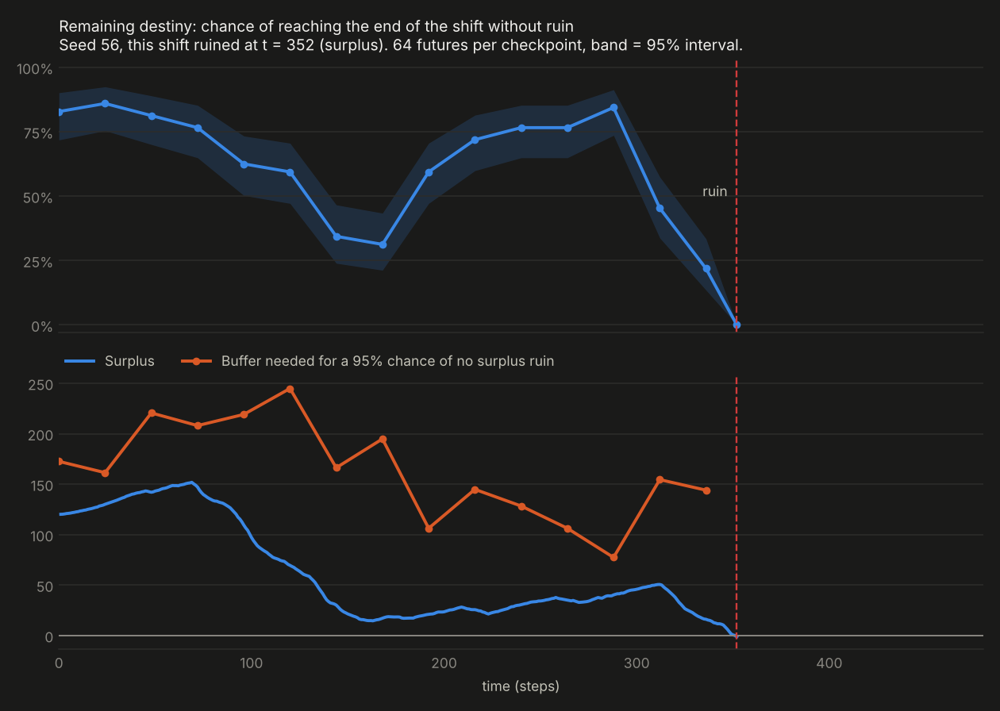

# RUIN: Ruin-probability Unified In Networks

**Destiny-framed ruin risk for stochastic logistics flow.**

[](https://www.python.org/)
[](https://opensource.org/licenses/MIT)
[](https://github.com/nezpik/ruin)

RUIN is a research-grade framework for measuring when physical logistics systems run out of destiny. It translates quantitative finance concepts (ruin theory, jump-diffusion, Monte Carlo paths, VaR, Expected Shortfall, bootstrap confidence intervals) into a logistics language built around **physical uncertainty**, **service failure**, and **systemic collapse**.

The central object is the **Probability Square** — an abstract two-dimensional **destiny frame `D`** inside which many **Q dots** (delivery commitments, route obligations, flow units) move through possible futures.

RUIN does not try to predict the future perfectly. It gives chaos a bounded frame so that uncertainty can move, organize, propagate, and become measurable.

---

## Core Philosophy

> A physical system ruins when it runs out of destiny.

In RUIN:
- **`D`** (the destiny frame) bounds all possible futures. Q dots cannot leave `D`.
- **Q dots** are quantized attempts at order — they drift, jump, cluster, stall, recover, fail, or ruin inside the frame.
- **Disruption** is spatial and propagating: a field that intensifies, spreads, decays, and reshapes movement.
- **Ruin** occurs when operational surplus is exhausted or service-level barriers are breached.
- **Visualization** is analysis: the Probability Square makes the negotiation between order and chaos visible.

---

## How the Model Works

- **Q dots travel and can succeed.** Each Q dot enters `D` with an origin, a destination, and a time window. Delivered on time, it earns surplus. Once late, it drains surplus every step until it is delivered late or abandoned.
- **Demand keeps arriving.** New Q dots enter every step, so the shift is a flow, not a fixed population running down a clock.
- **Travel is a jump-diffusion.** Progress per step is drift slowed by local field drag, plus Gaussian noise, minus occasional compound Poisson setbacks.
- **Disruption is a field of events.** Shocks land on the grid, spread to neighbouring cells, and fade. The field is subcritical by construction: a shock can never amplify itself. By default it reflects at the edges: disruption, like Q dots, cannot leave `D`.
- **Q and D co-evolve.** The field slows Q dots; late and failed Q dots add disruption where they stand.
- **Ruin is uncertain.** With no disruption the reference shift never ruins. With the calibrated disruption level about one shift in eight does, at very different times, some by exhausting the surplus and some by breaching the SLA.

Everything is seeded and reproducible, Monte Carlo runs in parallel, and a 480-step path takes about 0.2 s.

See [CHANGELOG.md](CHANGELOG.md) for what changed in each version and how to migrate a config.

---

## Quickstart

### Install (with uv — recommended)

```bash
git clone https://github.com/nezpik/ruin.git
cd ruin
uv sync --dev
```

Alternatively (classic pip):

```bash
python -m pip install -e ".[test]"
```

Requires Python ≥ 3.11. Core dependencies: `numpy`, `pydantic`, `matplotlib`, `pyyaml`.

### Run One Visible Trajectory + GIF

```bash
uv run ruin simulate --config examples/urban_ruin_shift.yaml --max-steps 150 --visualize --output /tmp/ruin_shift.txt
```

This produces:
- Text frames (`/tmp/ruin_shift.txt`)
- Real animated GIF (`/tmp/ruin_shift.gif`) showing the disruption field propagating, Q dots travelling to their destinations (magenta when late, green on delivery, red on failure), the D-state, and the pressures

### Run Monte Carlo Risk Analysis (Parallel)

```bash
uv run ruin risk --config examples/urban_ruin_shift.yaml --jobs 4
```

Example output for the 1,000 paths the config asks for (`time_to_ruin` list omitted):

```json
{
  "paths": 1000,
  "ruin_probability": 0.125,
  "ruin_probability_ci": [0.1059, 0.1469],
  "ruin_by_surplus": 73,
  "ruin_by_sla": 52,
  "mean_loss": 239.2149,
  "mean_loss_ci": [233.6229, 244.9512],
  "loss_std": 93.4473,
  "value_at_risk": 409.6681,
  "value_at_risk_ci": [393.0313, 432.9468],
  "expected_shortfall": 486.4877,
  "expected_shortfall_ci": [460.7321, 511.6302],
  "loss_share_by_type": {"STANDARD": 0.1736, "EXPRESS": 0.8009, "BULKY": 0.0255},
  "expected_shortfall_by_type": {"STANDARD": 90.864, "EXPRESS": 376.2256, "BULKY": 19.3981},
  "share_of_qdots_with_loss": 0.011846,
  "loss_share_of_top_1pct_qdots": 0.9676,
  "mean_final_surplus": 144.6213,
  "mean_min_surplus": 81.543,
  "mean_on_time_rate": 0.9877,
  "mean_time_to_ruin": 284.51,
  "confidence_level": 0.95,
  "n_jobs": 4
}
```

How to read it:

- Every `*_ci` is a confidence interval at `confidence_level`. The ruin probability uses a Wilson interval, which stays informative even when no path ruins. The loss figures use a bootstrap.
- Each path runs to the end of the shift even after it ruins, so the loss figures describe whole shifts and are not cut off at the moment of ruin.
- `ruin_by_surplus` / `ruin_by_sla` say which barrier was hit first. The SLA is breached when the share of deadlines missed over the last `sla_window` steps reaches `sla_threshold`.
- `expected_shortfall_by_type` splits the Expected Shortfall among Q-dot types; the parts add up to the total.
- `share_of_qdots_with_loss` and `loss_share_of_top_1pct_qdots` say how concentrated the loss is. Here about 1% of Q dots carry essentially all of it.

The `--jobs` flag controls parallelism (defaults to available cores).

---

## Remaining Destiny

`ruin risk` answers "how often does a shift like this ruin?". `ruin destiny` answers the question the project is named for: *how much destiny does this shift have left, right now?*

```bash
uv run ruin destiny --config examples/urban_ruin_shift.yaml --seed 56 --plot destiny.png
```

It follows one shift. Every 24 steps it freezes the exact present (every Q dot, every cell of the disruption field, the surplus, the SLA window) and plays 64 independent futures forward from it. The share that reach the end of the shift without ruin is the shift's **remaining destiny** at that moment:

```text
destiny(t) = P(no ruin before the horizon | everything known at t)
```



This shift started with an 83% chance, fell to 31% as its surplus drained, recovered to 84%, then lost its destiny for good and ruined at step 352. The lower panel shows why: surplus against the buffer the shift would need, at each moment, for a 95% chance of never touching the surplus barrier. Each checkpoint also reports the expected loss still to come and how the ruined futures split between surplus and SLA.

At `t = 0` the remaining destiny is one minus the ruin probability, so the two commands cross-check each other.

---

## Who Carried the Loss

Every Q dot has a ledger entry: where it entered, where it was going, how it ended, and how much loss it carried. `ruin simulate` reports the largest contributors and how concentrated the loss was:

```bash
uv run ruin simulate --config examples/urban_ruin_shift.yaml --seed 56
```

The full ledger is `ProbabilitySquare.ledger()`; a trajectory result carries `top_contributors`, `loss_concentration`, and `loss_field` (loss accrued per cell). Set `visualization.heatmap_field: accumulated_loss` to watch the loss map build up in the GIF.

---

## Parameter Sensitivity and Uncertainty

A confidence interval says how well the simulation has converged for one exact set of parameters. It says nothing about whether those parameters are right.

```bash
uv run ruin sensitivity --config examples/urban_ruin_shift.yaml
```

moves each parameter down and up by 10% and ranks them by effect on the odds of ruin (200 paths each):

| Parameter (moved ±10%) | Ruin at −10% | Ruin at +10% | Elasticity |
| --- | --- | --- | --- |
| `qdots.*.time_window` | 74.0% | 0.5% | -31.6 |
| `processes.travel_drift` | 53.5% | 3.0% | -18.0 |
| `disruption_field.mean_initial_intensity` | 4.0% | 47.5% | +15.3 |
| `disruption_field.shock_arrival_rate` | 4.5% | 39.0% | +13.0 |
| `qdots.*.delay_penalty` | 8.0% | 16.5% | +4.1 |
| `qdots.*.completion_reward` | 14.0% | 8.5% | -2.8 |
| `processes.demand_arrival_rate` | 16.5% | 13.0% | -1.4 |
| `ruin.initial_buffer` | 11.5% | 9.5% | -1.1 |
| `processes.jump_intensity` | 13.5% | 13.0% | -0.2 |

An elasticity of 15 means a 1% increase multiplies the odds of ruin by about 1.16. The top four are differences far beyond Monte Carlo noise; the output flags the ones that are not (`within_noise`).

```bash
uv run ruin uncertainty --config examples/urban_ruin_shift.yaml
```

goes one step further. The config lists how well each parameter is known (`risk.parameter_uncertainty`: here shock rate, shock size, and demand to 10%, travel speed to 5%, jump rate to 20%). The command draws 40 plausible parameter sets and estimates the ruin probability for each. For the reference scenario the ruin probability across draws has a median of 16%, a 5% to 95% range of 0% to 75%, and averages 28%, against about 12% when the parameters are taken as exact. **For this model, not knowing the parameters matters far more than Monte Carlo error**, and admitting it roughly doubles the chance of ruin.

---

## Validation Against Ruin Theory

The spatial model has no closed-form answer, but the layer underneath it does. Strip away the grid, feed the same surplus process a constant premium and compound Poisson claims with exponential sizes, and the ruin probability is known exactly (Cramér-Lundberg):

```text
psi(u) = (lam * mu / c) * exp(-(1/mu - lam/c) * u)
```

```bash
uv run ruin validate
```

compares Monte Carlo estimates with that formula and exits non-zero if any exact value falls outside its interval. With 20,000 paths, claim rate 1, mean claim 1, premium 1.5:

| Initial surplus | Exact | Monte Carlo | 99% interval |
| --- | --- | --- | --- |
| 0 | 0.6667 | 0.6699 | 0.6613 to 0.6784 |
| 2 | 0.3423 | 0.3400 | 0.3314 to 0.3487 |
| 5 | 0.1259 | 0.1236 | 0.1178 to 0.1298 |
| 10 | 0.0238 | 0.0231 | 0.0205 to 0.0259 |

This validates the surplus accounting, ruin detection, the Monte Carlo estimator, and the Wilson interval. It does not validate the spatial dynamics, which are checked by behavioural tests (no disruption means no ruin, the disruption field's long-run level matches its theoretical value, a larger buffer never ruins sooner, and so on).

---

## AI Research Reports (optional)

RUIN can narrate a finished `simulate`/`risk` run into a markdown research
report — written in RUIN's own vocabulary (`D`, Q dots, D-state, surplus,
ruin) — using [OpenAI Codex](https://github.com/openai/codex) as a pure
text-generation engine. RUIN reads and summarizes the results itself,
builds the full prompt, and writes the report; Codex never touches the
filesystem (it runs in a read-only sandbox).

Install the optional `ai` extra:

```bash
python -m pip install "ruin[ai]"
```

This requires an authenticated local Codex session (`codex login`, or an
API key via `codex login --api-key`) — the SDK reuses your existing Codex
CLI credentials.

Then pass `--explain PATH` to either subcommand:

```bash
uv run ruin simulate --config examples/urban_ruin_shift.yaml --explain /tmp/trajectory_report.md
uv run ruin risk --config examples/urban_ruin_shift.yaml --paths 200 --explain /tmp/risk_report.md
```

**On reproducibility**: RUIN's simulations are seeded and deterministic, but
Codex's prose is not — the SDK exposes no seed/temperature control, so the
same `--explain` run can read differently each time. Rather than hide that,
each report brackets the narrative with two things RUIN keeps fully
deterministic and traceable instead:

- a **header** recording exactly which Codex turn produced it — requested
  model/effort, duration, token usage, and the thread/turn IDs — so the call
  itself is auditable even though its prose can't be regenerated; and
- an **appendix** echoing, verbatim, the exact compressed `result`/`config`
  summary Codex was given — generated by RUIN itself, not Codex, and
  reproducible byte-for-byte by re-running the same scenario and seed — so
  every claim in the narrative can be checked against the real numbers
  without leaving the document.

Add `--explain-effort LEVEL` (one of `none`, `minimal`, `low`, `medium`,
`high`, `xhigh`) to trade narrative depth for speed/cost — it's forwarded
straight through to Codex's reasoning-effort setting for that turn:

```bash
uv run ruin simulate --config examples/urban_ruin_shift.yaml \
    --explain /tmp/trajectory_report.md --explain-effort low
```

Omit it to use Codex's own default.

---

## Core Vocabulary (Preserved from v0.1)

- **Destiny frame `D`**: The bounded space in which all logistics futures unfold.
- **Probability Square**: The computational and visual representation of `D` (grid + field + state).
- **Q dot**: A quantized logistics commitment travelling from an origin to a destination, carrying a time window, a delay penalty, a completion reward, and field exposure.
- **Disruption Propagation Field**: Spatial memory of shocks that intensifies, propagates, decays, and recovers.
- **D-state**: Regime of the grid (`STABLE` → `STRESSED` → `DISRUPTED` → `CHAOTIC` → `RECOVERING` → `RUINED`).
- **Surplus process**: `U(t) = U(0) + C(t) - L(t)`. Ruin when `U(t) <= barrier` or SLA failure crosses threshold.

Full definitions and deeper philosophy are in `RUIN.md`.

---

## Current Architecture (v0.6.0)

```
ruin/
├── core/
│   ├── qdot.py              # Q-dot record, types, and statuses
│   ├── network.py           # Surplus & SLA tracking
│   └── processes.py         # Vectorized diffusion, jumps, shocks, batch travel
├── state_space/
│   ├── probability_square.py   # Main engine: Q dots as arrays, one step of D
│   └── disruption_field.py     # Subcritical spread-and-decay field
├── simulation/
│   └── agent_based.py
├── risk/
│   ├── ruin_probability.py     # Parallel MC, Wilson and bootstrap intervals, VaR/ES
│   ├── classical.py            # Cramér-Lundberg closed form and validation
│   ├── destiny.py              # Remaining destiny: branching futures from the present
│   └── uncertainty.py          # Parameter sensitivity and uncertainty
├── viz/
│   └── square.py               # Matplotlib FuncAnimation + real-field GIFs
├── ai/
│   └── narrator.py             # Optional Codex-powered AI research reports (--explain)
├── metrics/
│   └── pressure.py
├── config.py                   # YAML loading and validation
├── config_models.py            # Pydantic schema
└── cli.py
```

---

## What RUIN Is

- A **research instrument** for studying logistics ruin under bounded destiny
- A **visual + quantitative** tool for disruption propagation and order pressure
- A **fast, parallel, reproducible** Monte Carlo engine
- An **abstract but extensible** foundation (no real maps yet — by design)

---

## What RUIN Is Not (Yet)

- A GIS / real-road simulator
- A vehicle routing optimizer
- A calibrated production forecasting tool
- A reinforcement-learning environment

These are explicitly deferred until the abstract mechanics are solid and reproducible.

---

## Roadmap

**Done in v0.4 (model validity):** Q dots with destinations, arrivals, and completion; earned surplus; a subcritical disruption field; 2D travel with jumps; honoured ruin rule; a single validated configuration path; a reference scenario where ruin is uncertain.

**Done in v0.5 (validation):** agreement with the closed-form Cramér-Lundberg ruin probability; Wilson interval for ruin probability and bootstrap intervals for mean loss, VaR, and Expected Shortfall; losses measured over whole shifts; continuous integration; boundary modes, background risk, congestion memory, snapshot interval, and the visualization options wired to the config.

**Done in v0.6 (making destiny measurable):** remaining destiny as a curve over the shift; a per-Q-dot loss ledger, loss map, and Expected Shortfall split by type; parameter sensitivity and parameter uncertainty; an SLA defined on missed deadlines; a rebalanced reference scenario where both ruin barriers are live.

**Next (chaotic organization and hedging):**
- Detection of clusters, corridors, and ruin zones; shock attribution by `shock_types`
- Stronger Q-to-D feedback (congestion that slows travel), which today is weak
- Deadlines that depend on trip length: today a fixed promise makes long trips carry almost all the risk
- A policy layer: buffers, backup capacity, and rerouting compared by ruin probability reduced per unit cost

**Later (when the abstract core is trusted):**
- Real road graphs and spatial topologies
- Fleet/depot constraints
- Calibration against real logistics data
- Hedging and backup-capacity policies

---

## Run the Test Suite

```bash
uv run pytest -q          # full suite
uv run ruff check . && uv run ruff format --check .
uv run mypy ruin
```

All tests must pass before any research use of a commit.

---

## Academic Credit and Citation

RUIN was created by **Naji Zouiti**.

If you use RUIN, its concepts, terminology, code, or experimental outputs in academic work, please cite the project.

Suggested citation:

> Zouiti, Naji. RUIN: Ruin-probability Unified In Networks. v0.6.0, 2026.  
> GitHub: https://github.com/nezpik/ruin

BibTeX:

```bibtex
@software{zouiti_ruin_2026,
  author = {Zouiti, Naji},
  title = {RUIN: Ruin-probability Unified In Networks},
  year = {2026},
  version = {0.6.0},
  url = {https://github.com/nezpik/ruin}
}
```

---

## Philosophy (Closing)

RUIN does not smooth chaos away. It gives chaos a frame (`D`) so that the negotiation between order pressure and disruption can be watched, measured, and understood — until the system either preserves its destiny or runs out of it.

The Probability Square is not decoration. It is the laboratory in which we study when physical flow loses the ability to keep its promises.

---

*Maintained by Naji Zouiti • MIT License • 2026*